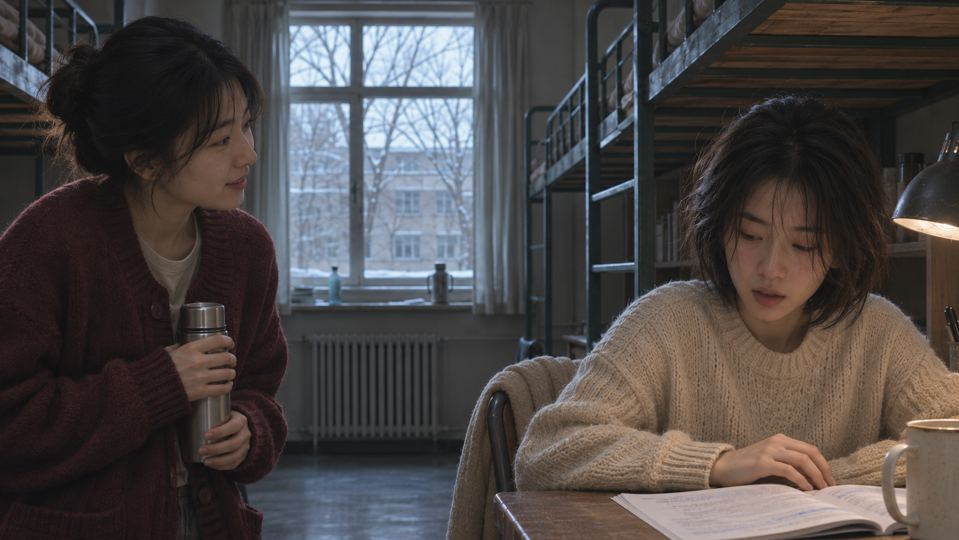

# 《配钥匙》

剧情短片｜剧本与分镜归档

## V10 · 现行生产版本

请从 [V10 剧本、镜头表与关键帧](production/v10/README.md) 开始。下方的 V09.1 及旧图仍是独立归档，不覆盖。

**戚禾起初不知道自己想要什么。** 她习惯替期待她的人给出答案，轮到被问自己想做什么，却答不上来。小时候的画没有替她定下未来；它让她认出自己也能判断、选择，并认真试着走一条路。

｜[故事主旨与人物逻辑](docs/story-canon.md)｜[V09.1 归档台本](docs/screenplay-v09.1.md)｜[开场摄影方案](docs/opening-cinematography.md)｜[预演时码](docs/animatic-timing.csv)｜[分镜与版本说明](docs/storyboard-index.md)｜[全分镜画廊](docs/gallery.md)｜[原图校验索引](docs/shot-file-map.csv)｜

## Cinema DNA · 369 张新版

[新版原图与验收记录](production/cinema-dna/README.md) · [查找每个原镜号](production/cinema-dna/shot-index.csv)

新版采用逐场检查光位、空间和动作连续性的摄影流程。以下上一轮重拍完整保留；现行剪辑仍以 V10 为准。

## 369 张旧分镜 · 重拍已完成

[重拍原图与批次](production/remake/README.md) · [逐镜最新版索引](production/remake/shot-index.csv)

369 个原镜号均有独立重拍 PNG；首批复核后另存 35 张新版，保留旧版和校验记录。旧剧情备选不混剪。正式剪辑仍以 V10 为准。

## V09.1 开场归档

V09.1 开头不演成「她已经决定当画家，只是不敢去做」。她先熟练地回家人一句「好」，再在室友的问题前沉默；早期笔尖描一下窗影只是无意识动作。后半段沿用铁盒、旧画和整盖自开的设计，最后让改变落回现实。

## 素材边界

- 全分镜画廊归档 **369 张生成画面的缩略预览**；当前开场另有 Q01–Q07 的单镜预览。旧图画廊只作预览；独立重拍原尺寸 PNG 见上方新目录。仓库不含实拍、未授权音频或成片。
- V07–V09 的旧版本用于核对制作过程。这一节历史版本以 V09.1 台本为依据，不覆盖 V10。
- 时码表的素材路径是剪辑工作目录的记录，不是仓库文件链接。以镜号、版本与校验值对照素材。
